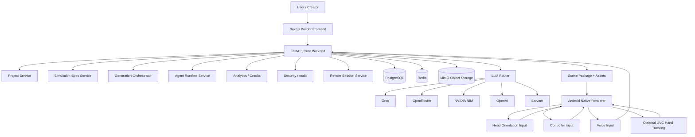
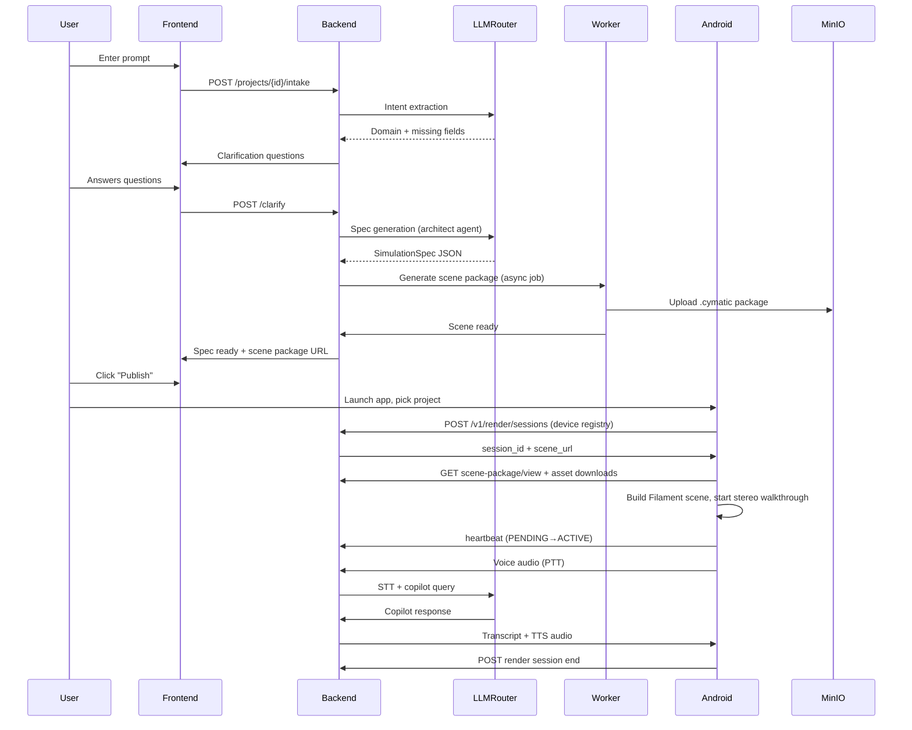

# CYMATIC System Architecture

## Architecture Goals

The architecture must support:
- no-code simulation generation
- AI-assisted scene creation
- structured validation
- on-device true stereo rendering
- low-end Android compatibility
- enterprise-ready security foundations
- future multi-domain expansion

---

## High-Level Architecture Diagram



---

## Core Components

### 1. Builder Frontend
No-code web application for simulation creation and management.

**Responsibilities:**
- prompt intake
- guided questions
- spec review
- manual editing
- publish workflow
- usage dashboard

**Key Features:**
- Prompt-to-Specification workflow with AI-guided clarification
- Real-time spec preview with 3D scene preview
- Manual scene editing with drag-and-drop
- Version control and spec history
- One-click publish to the on-device renderer
- Usage analytics and credit consumption dashboard

**Tech Stack:**
- Next.js 14 (App Router)
- TypeScript
- Tailwind CSS
- React Three Fiber / Three.js for 3D preview
- React Query / TanStack Query for data fetching
- Zustand for state management

---

### 2. Core Backend
Central control plane.

**Responsibilities:**
- authentication & authorization (JWT + RBAC)
- organizations/users management
- project lifecycle management
- simulation spec CRUD and versioning
- generation job orchestration
- asset management (upload, processing, CDN)
- render session management (mobile devices, heartbeats)
- analytics and credit tracking
- audit logging and compliance

**Tech Stack:**
- FastAPI (Python 3.11+)
- PostgreSQL 16 (asyncpg)
- Redis 7 (caching, queues, pub/sub)
- MinIO (S3-compatible object storage)
- Alembic migrations

---

### 3. LLM Router
Central AI access layer with intelligent routing.

**Responsibilities:**
- provider abstraction (Groq, OpenRouter, NVIDIA NIM, OpenAI, Sarvam)
- intelligent fallback routing with circuit breaker
- task-based model selection (intent, spec generation, validation, copilot, embeddings, STT, TTS)
- sensitivity-based routing (public/internal/tenant-sensitive/regulated)
- quota management and rate limiting
- usage logging and cost tracking
- response caching with TTL
- schema-enforced structured outputs
- automatic retry with exponential backoff

**Supported Providers:**
- Groq (Llama 3.1 8B/70B) - fast, free tier
- OpenRouter (Claude 3.5 Sonnet, Gemini Pro) - strong reasoning
- NVIDIA NIM (Nemotron 3 Ultra) - tenant-sensitive workloads
- OpenAI (GPT-4o, GPT-4o-mini, text-embedding-3-small) - regulated/sensitive
- Sarvam (Saarika STT, Bulbul TTS) - Telugu + 10 Indian languages

---

### 4. Android Native Renderer
On-device 3D walkthrough (Filament, stereo SBS). No server GPU.

**Responsibilities:**
- fetch scene package (`scene-package/view`) + asset downloads
- render stereo cameras (left/right eye, IPD from settings)
- map `cymatic_v1` entities to meshes (GLB-or-primitive fallback)
- guided tour along navigation paths + free look
- gaze dwell (2 s), controller, push-to-talk voice + TTS replies
- render sessions with heartbeat (`/v1/render/*`)
- thermal monitoring and resolution scaling

**Tech Stack:**
- Kotlin + Filament (`filament-android`, `gltfio-android`)
- SensorFusion head pose, GazeSelector, ControllerManager
- Retrofit + Gson, EncryptedSharedPreferences

See `docs/05-mobile-render.md` and `docs/27-mobile-render-pivot.md`.
The legacy Unity render/streaming server is frozen (appendix in `05`).

---

### 5. Walkthrough Preview (web viewer)
Lightweight Vite + Three.js SPA for previewing published packages in a
mobile/desktop browser. Reads `scene-package/view` only.

---

---

### 6. Data Layer
- **PostgreSQL 16**: relational data (projects, specs, users, sessions, audit logs)
- **Redis 7**: queues (Celery), cache, pub/sub, session state, rate limiting
- **MinIO**: assets (.glb/.gltf), scene packages (.cymatic), uploads, thumbnails

---

## Key Architecture Principles

### Specification-first
All simulations derive from a structured Simulation Specification (JSON Schema validated).

### Trusted builders
AI agents propose changes; trusted services validate and apply them.

### Feature-flagged experimentation
Hand tracking, UVC camera, advanced modules are optional (env flags).

### Latency-aware design
Render resolution scales to device thermal headroom; budgets enforced per spec.

### Domain-generic core
The core platform is reusable for future domains (medical, industrial, education).

### Security by default
- JWT with short-lived access + refresh tokens
- Tenant isolation on every query
- Audit logging for all mutations
- Sensitivity-based LLM routing (no tenant data to free providers)
- Signed scene packages (MinIO presigned URLs)

---

## Data Flow: Prompt to VR Experience



---

## Deployment Architecture

### Local Development
```
┌─────────────────────────────────────────────────────────────┐
│                    Developer Machine (Windows)              │
│  ┌─────────────┐  ┌─────────────┐  ┌─────────────────────┐ │
│  │   Docker    │  │  Android    │  │   Next.js Frontend  │ │
│  │  Compose    │  │  Studio +   │  │   + Viewer          │ │
│  │  (Postgres, │  │  Phone      │  │   (Ports 3000/8090) │ │
│  │  Redis,     │  │  (OnePlus   │  │                     │ │
│  │  MinIO)     │  │  6T, Filament│ │                     │ │
│  └─────────────┘  └─────────────┘  └─────────────────────┘ │
│                                                             │
│  ┌─────────────┐  ┌─────────────┐  ┌─────────────────────┐ │
│  │   FastAPI   │  │   Worker    │  │    LLM Router       │ │
│  │   Backend   │  │  (Python)   │  │    (Port 8001)      │ │
│  │  (Port 8000)│  │  (Port 8002)│  │                     │ │
│  └─────────────┘  └─────────────┘  └─────────────────────┘ │
└─────────────────────────────────────────────────────────────┘
```

### Production (Cloud)
```
┌──────────────────────────────────────────────────────────────┐
│                      Kubernetes Cluster                        │
│  ┌──────────┐ ┌──────────┐ ┌──────────┐ ┌─────────────────┐  │
│  │  Ingress │ │  FastAPI │ │  Worker  │ │   LLM Router    │  │
│  │  (Nginx) │ │  (x3)    │ │  (x2)    │ │   (FastAPI)     │  │
│  └──────────┘ └──────────┘ └──────────┘ └─────────────────┘  │
│                                                              │
│  ┌──────────┐ ┌──────────┐ ┌──────────┐ ┌────────────────┐  │
│  │ PostgreSQL│ │  Redis   │ │  MinIO   │ │  Viewer (static) │  │
│  │  (Primary)│ │  Cluster │ │  (S3 API)│ │  (Port 8090)     │  │
│  └──────────┘ └──────────┘ └──────────┘ └────────────────┘  │
└──────────────────────────────────────────────────────────────┘
```

---

## Security Considerations

| Layer | Measures |
|-------|----------|
| **Transport** | TLS 1.3 everywhere (Let's Encrypt / cert-manager) |
| **Authentication** | JWT (RS256), short-lived access (15m) + refresh (7d) |
| **Authorization** | RBAC (Owner/Admin/Creator/Viewer/Auditor), tenant isolation |
| **API** | Rate limiting (Redis), input validation (Pydantic), CORS |
| **LLM** | Sensitivity routing, no tenant data to free providers |
| **Storage** | MinIO SSE-S3, presigned URLs (1hr TTL), bucket policies |
| **Database** | Row-level security, encrypted connections, encrypted at rest |
| **Render sessions** | Device registry, per-user session guard, presigned scene/asset URLs (1hr TTL) |
| **Audit** | Immutable logs (append-only), correlation IDs, 90-day retention |

---

## Scaling Strategy

| Component | Horizontal Scaling | Limits |
|---------|-------------------|--------|
| FastAPI | Stateless, k8s HPA (CPU>70%) | 100 req/s per pod |
| Worker | Stateless, k8s HPA (queue depth) | 10 concurrent jobs |
| LLM Router | Stateless, k8s HPA (latency) | 50 req/s per pod |
| Android render | On-device Filament | 1 concurrent session/user |

---

## Monitoring & Observability

| Layer | Tools | Key Metrics |
|-------|-------|-------------|
| **Infrastructure** | Prometheus + Grafana | CPU, RAM, disk, network, GPU |
| **Application** | Structured logs (structlog), OpenTelemetry | Latency p50/p95/p99, error rate, throughput |
| **Business** | Custom events (PostgreSQL) | Spec generation time, stream start time, session duration |
| **LLM** | Custom dashboard | Token usage, cost, latency, fallback rate |
| **On-device render** | Android diagnostics + session analytics | FPS, draw calls, tris, thermal, tour completion |

---

## Disaster Recovery

| Scenario | RPO | RTO | Mitigation |
|----------|-----|-----|------------|
| PostgreSQL primary failure | <1s | <30s | Streaming replica + auto-failover (Patroni) |
| Redis failure | <1s | <10s | Redis Sentinel (3 nodes) |
| MinIO failure | <1min | <5min | Erasure coding (4+2), cross-region replication |
| Render device failure | N/A | Manual | Spare test phone, re-login + new session |
| Region outage | <1hr | <4hr | Cross-region backup (daily snapshots) |

---

*Last updated: 2026-10-02 (mobile-render pivot; Unity path frozen, see docs/27)*
*Version: 1.1*