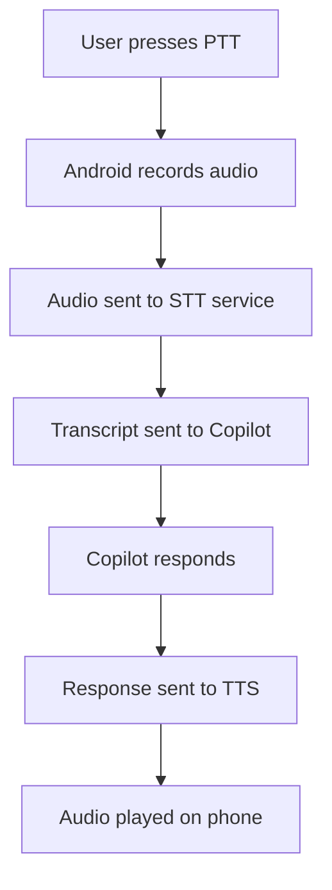
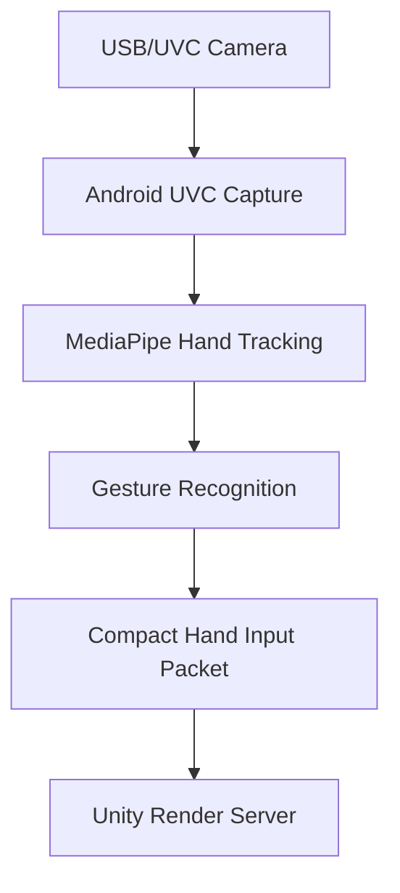

# CYMATIC Unity Runtime, Android Client, and Input System

## Unity Render Server

### Purpose
The Unity Render Server runs the generated simulation and streams true stereo video to the Android client.

### Deployment
For MVP:
- run as native Windows application
- run on gaming laptop
- communicate with backend over local LAN
- do not containerize initially

---

## Unity Responsibilities

- load published scene package
- initialize simulation state
- render stereo cameras
- encode side-by-side video
- handle WebRTC session
- receive input packets
- execute permitted agent commands
- emit runtime events

---

## Stereo Rendering Model

### Camera Rig
Use:
- left eye camera
- right eye camera
- configurable IPD
- head pose driven by phone orientation

### Stream Output
Side-by-side stereo frame:

```text
[ Left Eye | Right Eye ]
```

### Streaming Targets
- adaptive quality enabled
- default low preset first
- target 30 fps minimum
- aim for 60 fps where possible
- prioritize latency over maximum resolution

---

## Encoding Strategy

Preferred:
- hardware encoding if available
- H.264 first for compatibility

Later:
- H.265/AV1 if supported and beneficial

Fallback:
- software encoding only if necessary

---

## Android Client

### Purpose
The Android client is the VR streaming client running on a phone inserted into a headset.

### Target Devices
Primary:
- OnePlus 6T

Secondary:
- Redmi Note 8

Low-end testing:
- Redmi Note 7

---

## Android Client Responsibilities

- receive WebRTC stream
- display side-by-side stereo video
- read phone IMU orientation
- handle controller input
- handle gaze dwell UI
- handle push-to-talk voice
- send compact input packets
- optionally process external UVC camera hand tracking

---

## Input System

### Primary Input Modes
1. Gaze dwell
2. Controller buttons
3. Voice push-to-talk

### Experimental Input Mode
4. Wired UVC camera hand tracking

---

## Gaze Dwell Interaction

Behavior:
- user looks at target
- reticle appears
- dwell timer fills
- action triggers

Use for:
- menu selection
- navigation
- object inspection
- copilot prompt selection

---

## Controller Input

Expected buttons:
- select
- back/menu
- voice PTT

Mapping:
- Select: confirm gaze target
- Menu: open/close menu
- PTT: press and hold to speak

Controller input must work without hand tracking.

---

## Voice Interaction

### Voice Model
Push-to-talk only in MVP.

No:
- always-on listening
- wake word
- continuous capture

### Voice Flow


### Voice Requirements
- language selectable
- include Telugu
- fallback provider support
- voice session logging
- text transcript fallback UI

---

## Hand Tracking Module

### Status
Experimental.
Disabled by default.

### Recommended Hardware
Wired USB/UVC mini camera mounted on headset.

### Camera Requirements
- 720p30 minimum
- wide-angle lens
- low latency
- UVC class compliance
- Android UVC support
- wired connection

### Hand Tracking Flow


### MVP Hand Scope
- stylized virtual hands
- gesture-based UI actions
- pseudo-3D pointer
- not full accurate world-space hand physics

### Gesture Mapping
| Gesture | Action |
|---|---|
| pinch | select |
| open palm | menu |
| fist | close/cancel |
| swipe | navigate/change option |

### Fallback Rule
If hand confidence is low:
- hide virtual hands
- return to gaze/controller
- keep experience stable

---

## External Mini Camera Policy

- wired UVC only
- wireless camera not recommended
- optional module only
- must not block core experience
- disable automatically if unsupported

---

## Performance Policy

On low-end devices:
- disable hand tracking by default
- reduce resolution
- reduce effects
- prioritize stream stability
- monitor thermal state