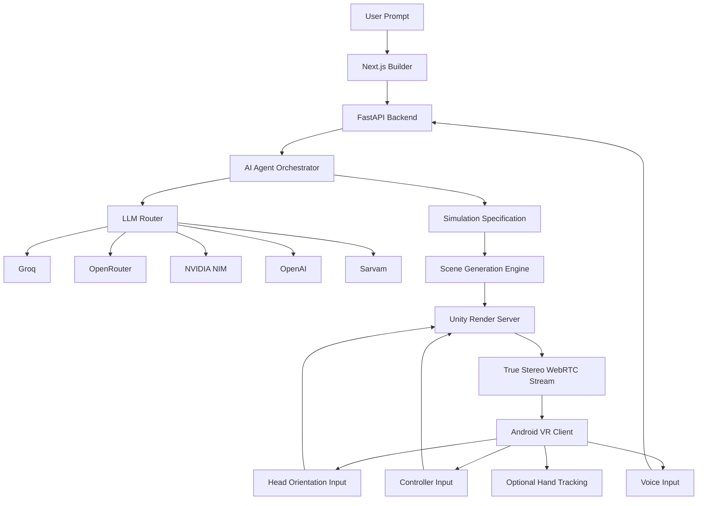
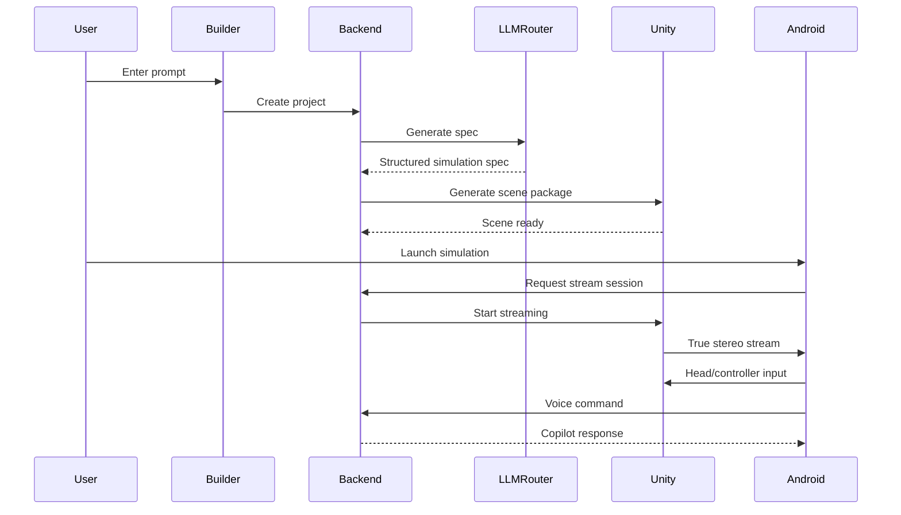

# CYMATIC
## No-Code AI Simulation Builder for Immersive Real Estate and Heritage Experiences

---

## One-Line Pitch

**CYMATIC converts a simple prompt into an interactive VR walkthrough with an AI copilot inside it.**

---

## Problem

Creating immersive 3D simulations is currently:
- expensive
- slow
- technically complex
- dependent on specialized developers
- difficult to update
- inaccessible for non-technical teams

This is especially painful in:
- real estate visualization
- heritage walkthroughs
- training simulations
- client presentations
- education experiences

Most teams cannot rapidly create interactive VR experiences from ideas.

---

## Solution

**CYMATIC** is a no-code AI simulation builder.

Users describe what they want:
> “Create a furnished 3-bedroom apartment walkthrough with warm lighting and a guided tour.”

The system then:
1. asks smart follow-up questions
2. generates a structured simulation specification
3. builds the 3D scene
4. publishes it to a VR streaming runtime
5. embeds an AI copilot inside the experience
6. lets users explore using gaze, controller, and voice

---

## Why This Matters

CYMATIC makes immersive simulation creation:
- faster
- cheaper
- accessible
- editable
- scalable
- enterprise-ready

It transforms VR from a custom development project into a **generative workflow**.

---

## Key Features

### 1. Prompt-to-Simulation Generation
Users can create simulations using natural language.

### 2. No-Code Builder
Non-technical users can:
- enter requirements
- review generated structure
- edit scenes
- publish experiences

### 3. AI Copilot Inside the Simulation
The copilot can:
- answer questions
- guide users
- highlight objects
- suggest next actions
- provide voice-based help

### 4. True Stereo VR Streaming
The experience is streamed in true stereo to an Android phone placed inside a VR headset.

### 5. Voice Interaction
Users can speak to the copilot using push-to-talk.

Supported language direction:
- multi-language support
- Telugu included
- configurable language selection

### 6. Real Estate + Heritage Focus
Initial use cases:
- apartment walkthroughs
- house walkthroughs
- heritage courtyards
- palace halls
- monument previews

---

## Target Users

### Real Estate
- architects
- builders
- interior designers
- real estate agents
- client presentation teams

### Heritage
- tourism departments
- museums
- cultural organizations
- heritage preservation teams
- educational institutions

### Enterprise
- training teams
- innovation labs
- visualization teams

---

## Demo Scenario

### Scenario 1: Real Estate Walkthrough
A user enters:

> “Generate a modern furnished 3-bedroom apartment walkthrough with warm lighting and a guided tour.”

CYMATIC:
- asks for style and size preferences
- generates the apartment
- publishes it
- user enters VR
- copilot guides the tour
- user asks questions by voice
- copilot highlights rooms and features

---

### Scenario 2: Heritage Walkthrough
A user enters:

> “Create a heritage palace courtyard walkthrough with explanatory narration.”

CYMATIC:
- generates a heritage-themed environment
- places points of interest
- adds copilot explanations
- user explores in VR
- copilot describes key elements

---

## System Architecture

---

## Core Product Flow

---

## Technology Stack

| Layer | Technology |
|---|---|
| Frontend | Next.js |
| Backend | Python FastAPI |
| Database | PostgreSQL |
| Cache/Queue | Redis |
| Object Storage | MinIO |
| AI Routing | LiteLLM-style router |
| AI Providers | Groq, OpenRouter, NVIDIA NIM, OpenAI, Sarvam |
| Simulation Runtime | Unity |
| Streaming | WebRTC |
| Android Client | Kotlin |
| Infra | Docker, WSL2, Kubernetes-ready |

---

## What Makes CYMATIC Innovative

### 1. Generative Simulation Workflow
Instead of manually building VR scenes, users generate them.

### 2. Embedded AI Copilot
The simulation is not static.
It has an assistant inside it.

### 3. Domain-Generic Architecture
Although MVP focuses on real estate and heritage, the same architecture can expand into:
- medical training
- engineering labs
- education
- industrial simulations

### 4. Enterprise-Friendly Design
The platform includes:
- structured specs
- validation
- auditability
- provider routing
- security controls

---

## Business Model

### Usage-Based Credits
Customers consume credits for:
- simulation generation
- scene publishing
- stream session minutes
- copilot usage
- voice usage
- storage

### Potential Revenue Streams
- monthly credit packs
- enterprise contracts
- heritage/tourism packages
- real estate presentation plans
- education institution licenses
- marketplace for templates/plugins later

---

## Market Opportunity

### Real Estate
- property marketing
- interior visualization
- client presentations

### Heritage/Tourism
- immersive cultural experiences
- virtual tours
- educational exhibits

### Enterprise Training
- guided walkthroughs
- onboarding
- safety orientation

### Education
- interactive learning environments
- virtual labs
- spatial understanding

---

## MVP Scope

### Included
- real estate walkthrough generation
- heritage template walkthrough
- single-user experience
- Android phone VR streaming
- gaze + controller + voice interaction
- AI copilot
- basic manual editing
- usage tracking

### Not Included Yet
- multiplayer
- public marketplace
- full medical simulation
- full engineering simulation
- standalone headset native app
- local LLM hosting

---

## Technical Highlights

### Specification-First Generation
Every simulation starts from a structured specification.

This makes CYMATIC:
- more reliable
- easier to validate
- easier to extend
- easier to audit

### Agent-Assisted Creation
Specialized agents handle:
- requirement gathering
- domain logic
- scene composition
- validation
- runtime assistance

### Secure LLM Routing
CYMATIC routes AI tasks through a central router with:
- provider fallbacks
- usage tracking
- sensitivity policies
- language support

### Streaming-First VR
The MVP uses true stereo streaming to make immersive experiences accessible on mobile devices.

---

## Future Roadmap

### Phase 1: MVP
- real estate + heritage
- Android streaming
- voice copilot
- basic editing

### Phase 2: Platform Expansion
- more domains
- improved editor
- better streaming quality
- multiplayer/instructor mode

### Phase 3: Ecosystem
- plugin SDK
- template marketplace
- enterprise integrations
- advanced analytics

---

## Social Impact

CYMATIC can help:
- preserve and present heritage sites
- make education more immersive
- reduce cost of visualization
- enable smaller businesses to use VR
- create accessible training experiences

---

## Why We Can Build This

We have defined:
- a clear MVP scope
- a practical architecture
- a realistic streaming strategy
- a strong AI routing model
- an agent-friendly development plan
- a phased roadmap

We are not trying to build everything at once.
We are building the most valuable loop first:

> **Prompt → Simulation → VR Experience → AI Copilot Assistance**

---

## Closing Statement

CYMATIC turns ideas into immersive experiences.

It makes VR creation feel less like software development and more like describing what you want.

With generative AI, structured simulation design, and an embedded copilot, CYMATIC is building the foundation for the next generation of no-code immersive simulation platforms.
